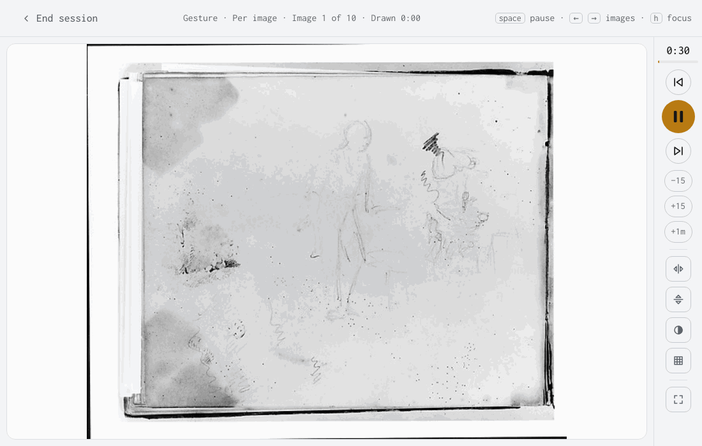
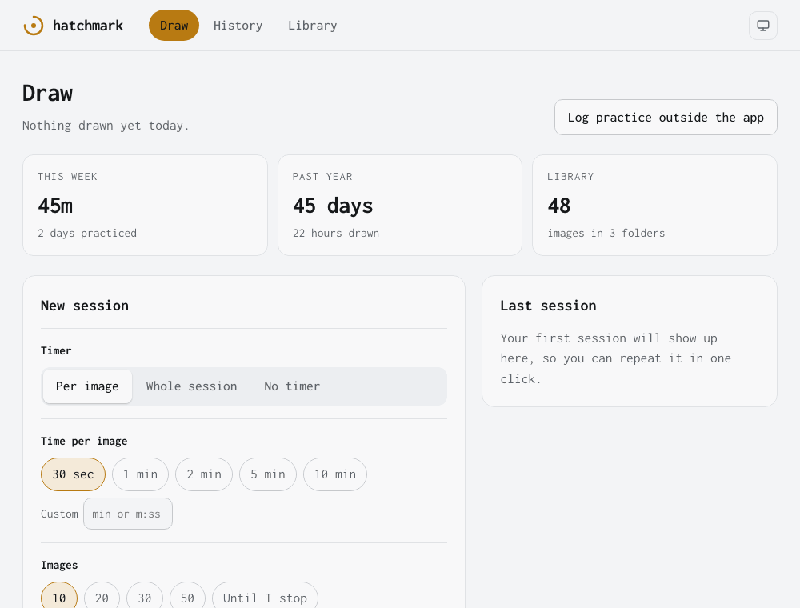
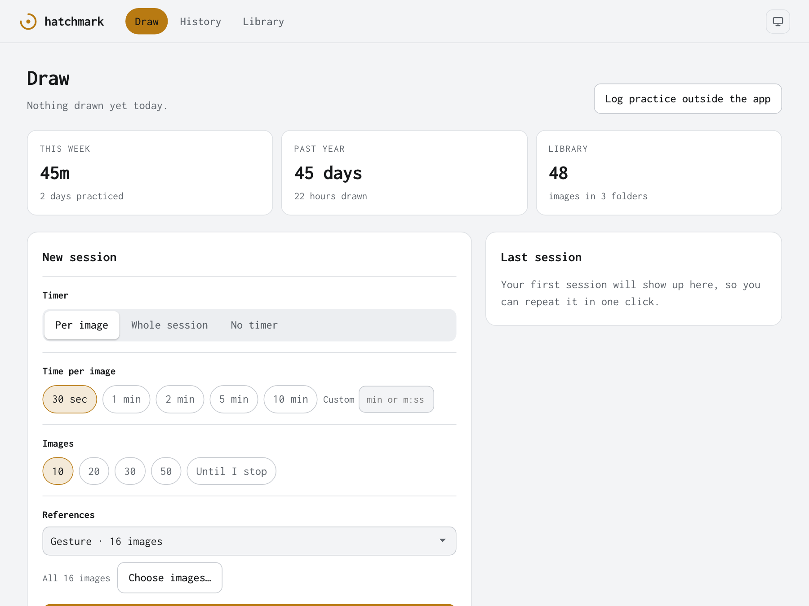
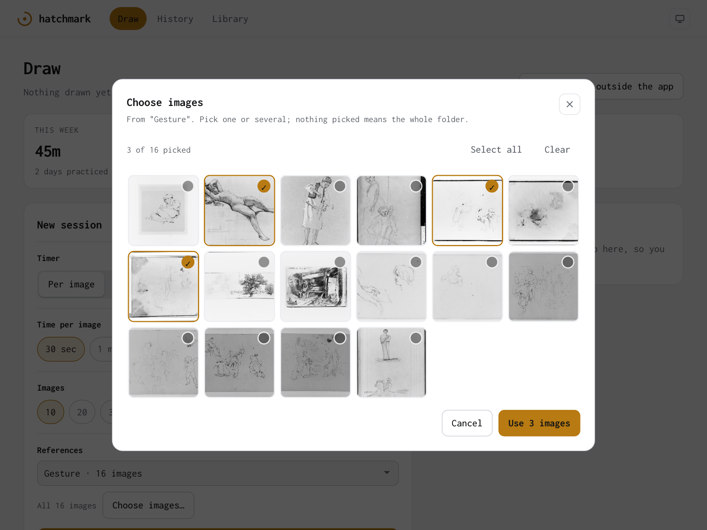
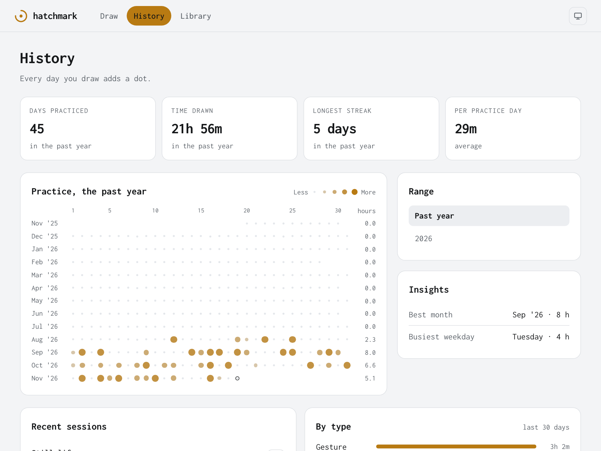
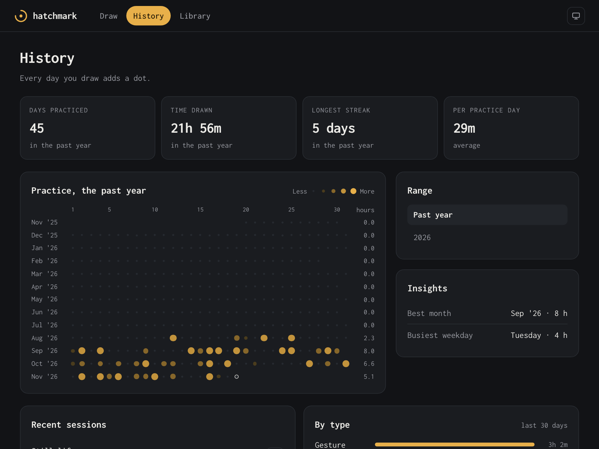

# Hatchmark

Drawing-reference practice timer for the desktop. Point it at folders of reference images, pick a timer, draw, and watch a heatmap of the days you practiced fill in.

<div align="center">

[](https://github.com/hugommartins/drawing-practice-timer/actions/workflows/ci.yml)
[](https://hugommartins.github.io/drawing-practice-timer/)

   [](LICENSE)

**[Try the demo in your browser](https://hugommartins.github.io/drawing-practice-timer/)**: the real interface with sample data, nothing to install.

[Features](#features) · [Install](#install) <br>
[Getting references](#getting-references) · [Your data](#your-data) <br>
[Testing](#testing) · [Roadmap](#roadmap)



</div>

## Features

| | |
|---|---|
| **Local references** | Link any folder. The folder name is the drawing type ("Figure", "Hands"); subfolders are included. Nothing is copied or uploaded. |
| **Pick your images** | Use the whole folder, or choose a single image or any set of them from a thumbnail picker. The choice is remembered, and "Repeat this setup" reuses it. |
| **Timers** | Per image, whole session, or none. Adjust on the fly with ±15 s / +1 m. See [Timer modes](#timer-modes). |
| **Tracking** | Heatmap by month × day, past year or any single year, with streaks and per-type totals. Log practice you did away from the app. |
| **View tools** | Mirror, flip, greyscale and a grid overlay that always sits exactly on the image. |
| **Light, dark or follow the system** | The layout follows the window size. |

## Screenshots
<div align="center">

</div>

| Practice | Picking images |
|---|---|
|  |  |
| **History** | **History, dark theme** |
|  |  |

## Timer modes

Pick one when you start a session. The default is per image, 1 minute, 20 images.

| | Per image | Whole session | No timer |
|---|---|---|---|
| Countdown | One for each image | One for the whole sitting | None. Time still counts up |
| Choices | 30 s, 1, 2, 5 or 10 min, or a custom time. 10, 20, 30 or 50 images, or until you stop | 10, 20, 30, 60 or 120 min, or a custom time | |
| Next image | Automatically at zero, or when you press next | Only when you press next | Only when you press next |
| Ends | After the chosen number of images (or when the folder runs out), or when you stop | When the time is up, or when you stop | When you stop |
| ±15 s / +1 m | Changes the time on the current image | Changes the time left in the sitting | |
| Good for | Gesture drawing and quick studies, where every image has a limit | Longer studies, where you decide how long each image deserves | Slow work without a clock |

In every mode:

- **No repeats.** The folder is shuffled once and shown in order. A session with no image limit shuffles again after the last image.
- **Previous and next.** Go back to an earlier image or skip ahead. Going back to an image restarts its time.
- **Pause.** Paused time is not counted.
- **Stop any time.** Ending a session asks whether to save the time drawn so far, discard it, or keep drawing.
- **What is saved.** The type, the date, the mode, the number of images and the time actually drawn. Sessions under 20 seconds are not saved, and time while the computer sleeps is not counted.

## Choosing what to draw

The **New session** card on the Practice page sets the timer, the folder and the images. The folder's name becomes the drawing type, so every session is filed under "Figure", "Hands" and so on.

| | How |
|---|---|
| **The whole folder** | The default. Every image in the folder and its subfolders. |
| **A chosen set** | **Choose images** opens a thumbnail picker. Pick one or several, with **Select all** and **Clear**; picking nothing means the whole folder. **Use whole folder** goes back. |
| **Repeat a setup** | The **Last session** card reuses the folder, the images and the timer of your previous session in one click. **Clear** removes the card and leaves your history alone. |

The chosen images are remembered between sessions. If they are no longer in the folder, the app says so and asks you to choose again or use the whole folder.

## Tracking

| Where | What it shows |
|---|---|
| **Practice page** | This week (time drawn and days practiced), the past year (days and hours), and how many images are in your library. |
| **History: heatmap** | One dot per day you drew, laid out by month × day, for the past year or any single year that has data. |
| **History: numbers** | Days practiced, time drawn, longest streak and the average per practice day, for the range you chose. Best month and busiest weekday. |
| **History: by type** | Time per drawing type over the last 30 days. |
| **History: recent sessions** | Each session with its type, date and time. Delete one (it asks first). |

**Log practice outside the app**, such as a life drawing class: give the date, how long and the drawing type. It counts toward the week, the heatmap and the streaks, and is marked **Logged** in History.

## Reference tools

In a session, the side panel has these. Each is a toggle and works on the image only, never on the file.

| Tool | Key | What it does |
|---|---|---|
| Mirror | `m` | Flips the image left to right, to check your drawing with fresh eyes |
| Flip | `f` | Flips it top to bottom |
| Greyscale | `b` | Removes colour, to judge values |
| Grid | `g` | Overlays a 2×2 to 6×6 grid (3×3 to start) that always sits exactly on the image |
| Focus | `h` | Hides the controls so the image fills the window. `esc` or `h` brings them back |
| Pause or resume | `space` | Stops and restarts the clock |
| Previous / next image | `←` `→` | |

## Install

New to this? Follow **[INSTALL.md](INSTALL.md)**: step by step for macOS and Windows, with fixes for the common errors. No coding needed.

For developers: Node 22, `npm install`, `npm start` (build and launch), `npm run dev` (rebuild on change).

## Getting references

Hatchmark reads folders, so any source works once its images are in one. Put them in a folder named for the drawing type and link it.

For online collections, a downloader like [gallery-dl](https://github.com/mikf/gallery-dl) can save a whole board or gallery to a folder. It supports Pinterest boards and many other image sites (check its supported-sites list). Respect each site's terms and the artists' rights; references stay on your machine and are only used for practice.

```bash
gallery-dl -d ~/Pictures/refs "https://www.pinterest.com/<user>/<board>/"
```

Then use **Link a folder** in the Library. Re-run the command to refresh the folder, then **Rescan**.

## Library

The Library page lists the folders you linked, with their image counts. Folders are read in place: nothing is copied or uploaded, subfolders are included and hidden files are skipped.

| Action | What it does |
|---|---|
| **Link a folder** | Adds a folder. Its name becomes the drawing type. |
| **Rename** | Changes the drawing type. |
| **Change folder** | Points the entry at the folder's new location after you moved it. Your past sessions stay. |
| **Rescan** | Reads the folder again after you added or removed images. |
| **Remove** | Unlinks the folder. The folder, its images and your past sessions are not touched. |

If a folder cannot be found (a disconnected drive, say) it stays in the list as "Folder not found" and cannot be drawn from until it is back.
## Your data

Plain files, in one folder you can back up or read:

On macOS: `~/Library/Application Support/Hatchmark/data/`
On Windows: `%APPDATA%\Hatchmark\data\`

| File | Contents |
|---|---|
| `collections.json` | linked folders |
| `sessions.jsonl` | one JSON line per session; deleting adds a tombstone line (append-only) |
| `settings.json` | theme, last setup, last session |

Sessions shorter than 20 seconds are not saved. Time while the computer sleeps is not counted.

## Tests

Layers, rationale and test hooks: [TESTING.md](TESTING.md).

## Limitations

- Desktop only, on macOS and Windows. No mobile app, and Linux is on the roadmap.
- No accounts and no sync: your data lives in one folder on one computer. Export is on the roadmap.
- No-repeat applies within a session, not across sessions.
- The builds are not code-signed, so Windows and macOS may warn the first time. [INSTALL.md](INSTALL.md) covers it.
- Very large originals, such as a 48-megapixel PNG, are decoded in full in a session. The picker shows small previews.
- Only common image formats are read: JPG, PNG, WebP, GIF, AVIF and BMP.

## Roadmap

Next up:

- [x] Keyboard shortcuts: space to pause, arrows for previous/next, `M` mirror, `F` flip, `B` greyscale, `G` grid, `H` focus
- [x] No-repeat shuffle within a session: an image is not shown again until the folder is exhausted
- [ ] Remember which images were shown across sessions
- [ ] Sound when an image's time is up
- [ ] Skip or hide a reference permanently
- [ ] Resume an interrupted session after the app closes

Practice:

- [ ] Daily and weekly goals per drawing type, shown on the heatmap and Practice page
- [ ] Always-on-top floating reference window

Data:

- [ ] Export and import all data as a single zip
- [x] Re-link a moved folder without losing history (**Change folder** in the Library)

Platforms:

- [ ] Linux support. Electron already runs there and the app code is platform-neutral. Remaining: Linux visual baselines (`-linux`, `-linux-ci`) and a CI job under `xvfb-run`, an `install:linux` script, a check of the "Link a folder" dialog on Wayland and X11, and a Linux section in [INSTALL.md](INSTALL.md)

Performance and robustness:

- [x] Large folders: the picker draws only the rows in view and shows small cached previews instead of the original files
- [ ] A scan that finishes late must not overwrite a newer one (after a rescan, or after re-linking a folder, the old folder's list can replace the new one)
- [ ] One slow or unreachable folder must not hold up the Library and Draw pages
- [ ] Two requests for the same folder at once (startup and a session start) share one scan instead of walking it twice
- [ ] Show very large originals at screen size in a session instead of decoding them whole (a 48-megapixel PNG costs about 190 MB)
- [ ] Performance baselines that allow for day-to-day variation between runs (`npm run perf:baseline` merging earlier runs)

Quality:

- [ ] Accessibility checks (axe-core) in the UI test layer
- [x] README screenshots and demo GIFs

Not planned: cloud sync, accounts, a mobile app.
